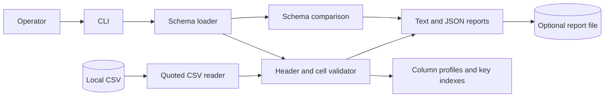

# High-level design

Dataset Release Checker 0.1.0 checks a local CSV export against a published JSON column contract. It targets Ubuntu with Python 3.10 or later and uses the Python standard library at runtime. The primary workflow is reviewing a monthly synthetic equipment inventory before publication.

## Workflows

| Command | Inputs | Result |
| --- | --- | --- |
| `validate` | One or more CSV files and one schema | File-level results, logical row and column diagnostics, and optional JSON report |
| `schema` | A schema file | Validated and normalized contract in text or JSON |
| `compare` | Earlier and later schemas | Deterministically ordered changes classified for release review |
| `codes` | Output format | Stable validation error codes and their meanings |

Required headers and nullable cells are independent schema properties. Missing optional headers skip the column's cell validation. Every present column is validated according to its type and constraints. A required nullable `location` column must appear in every header while allowing empty cells.

The validation command leaves the input files intact. It streams logical CSV records and retains diagnostic details, typed key indexes, and column statistics. Large records are bounded by a configurable byte limit. A cap can bound diagnostic details while total error counts continue to accumulate.

## Data and configuration

The schema controls column names and types, nullability, whitespace, enum and range constraints, uniqueness, boolean spellings, CSV conventions, and row-count bounds. CLI arguments supply file paths, report locations, strict mode, and resource limits. Examples use synthetic values and configurable paths. The application needs no login, passwords, API keys, environment file, database, or external service. Local `.env` files and CSV exports are ignored by Git, with an exception for checked-in synthetic fixtures.

## Release scope

The first release validates individual files and can apply the same schema independently to multiple files. Schema inspection, comparison, column profiles, and an error-code catalog support the release workflow. Data repair, schema inference, remote storage, and publication are outside the release. Schema comparison describes validation rules and requires consumer review for semantic expectations beyond those rules.
